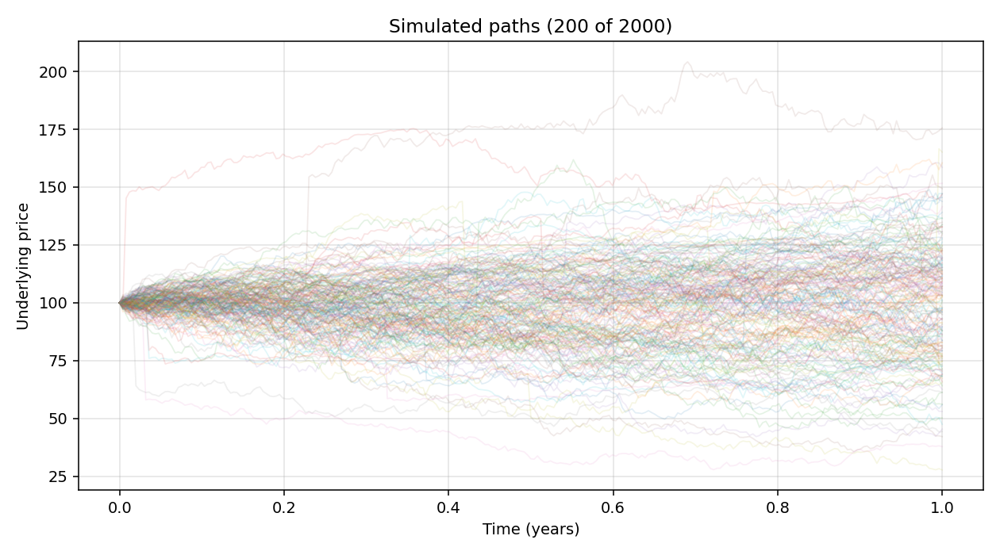
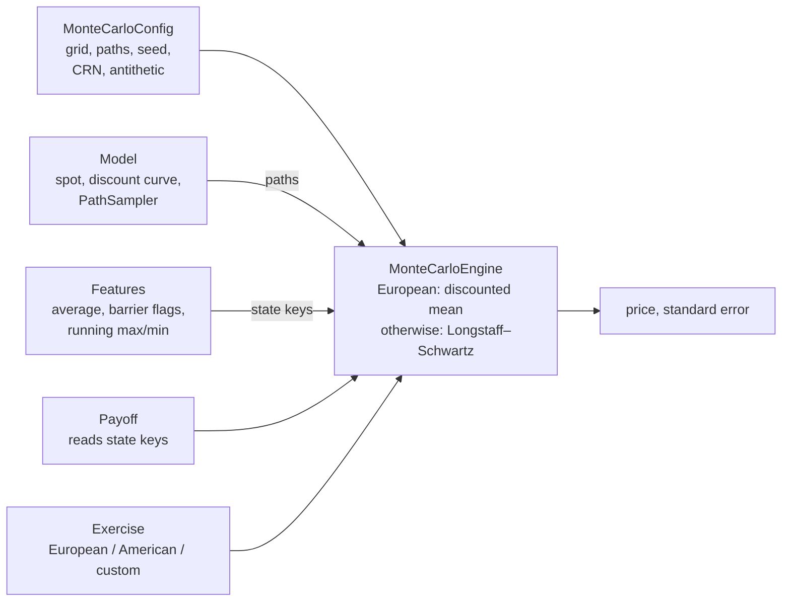

# option-pricer

[](https://github.com/oscar12351235/option-pricer/actions/workflows/ci.yml)

`option-pricer` is a Monte Carlo pricer for European and American options, including
path-dependent exotics, under the Heston stochastic-volatility model and its jump extension,
the Bates model. Variance paths are simulated with Andersen's Quadratic-Exponential (QE) scheme
in a parallel Numba kernel. Early exercise is handled by Longstaff–Schwartz regression. Products
are built by combining *features* of the path (average, barrier hits, running extrema) with
payoff classes that read them, so one engine prices vanilla, digital, Asian, barrier and lookback
options. Prices are validated against semi-analytic and lattice references (see
[Validation](#validation)).



*200 of 2,000 simulated Bates paths (252 steps over one year), produced by `run.py`;
regenerate with `poetry run python run.py --jump-kind lognormal --n-paths 2000 --plot
--plot-file docs/sample_paths.png --plot-max-paths 200`.*

## Models and methods

**Heston with the Andersen QE scheme (Numba).** `NumbaHestonSampler` advances the CIR variance
with the QE scheme of Andersen (2008): a moment-matched quadratic-Gaussian draw when
ψ = s²/m² ≤ 1.5 and an exponential distribution with an atom at zero otherwise. The variance is
therefore non-negative by construction, including when the Feller condition fails. The log-spot
uses Andersen's central discretisation of the integrated variance (γ₁ = γ₂ = ½) with his
martingale correction, so that E[S<sub>t+Δ</sub> | S<sub>t</sub>, V<sub>t</sub>] =
S<sub>t</sub> e<sup>(r−q)Δ</sup> on every step. Paths are simulated in parallel over the path
index with `numba.prange`.

**Bates with lognormal jumps.** Passing `jump=LognormalJumps(lam, mu, sigma)` to the same sampler
adds compound-Poisson jumps with log sizes J ~ N(μ<sub>J</sub>, σ<sub>J</sub>²) and intensity λ.
The drift is compensated by λ(e<sup>μ<sub>J</sub> + σ<sub>J</sub>²/2</sup> − 1), so the
discounted spot is a martingale. This is the convention of QuantLib's `BatesProcess`
(λ, ν, δ) = (λ, μ<sub>J</sub>, σ<sub>J</sub>), checked numerically in the test suite.

**Other models.** `VectorizedJumpGBMSampler` simulates Black–Scholes or the Merton (1976)
jump-diffusion exactly on the grid. `HestonModel` wraps QuantLib's `HestonProcess` (QE with
martingale correction) and term-structure handles; it serves as an independent cross-check.

**Longstaff–Schwartz regression.** For any exercise policy other than European, the engine
initialises each path's cash flow with the discounted payoff at maturity and steps backwards
over the exercise dates. At each date it regresses the discounted future cash flows of the
in-the-money paths on the basis

  {1, x₁, …, x<sub>d</sub>, x₁², …, x<sub>d</sub>²},

where x₁, …, x<sub>d</sub> are the state variables the payoff depends on at that date (no cross
terms). For an American vanilla this is {1, S<sub>t</sub>, S<sub>t</sub>²}; for an up-and-in
Asian call it is the running average and the knock-in indicator. A path exercises when its
immediate value exceeds the fitted continuation value. The same paths are used for the
regression and the valuation.

**Antithetic variates.** With `antithetic=True` the engine draws normals for half of the paths
and uses their negatives for the other half. The standard error is computed from the
n/2 pair averages, because paired paths are not independent.

**Common random numbers.** With `use_crn=True` the engine draws the normal tensor once, at
construction, and reuses it for every simulation it runs. Two engines built with the same seed
and grid see identical normals, which keeps the noise in differences between them small. The
Numba sampler takes all of its randomness from this tensor: uniforms for the QE exponential
branch and for the Poisson jump counts are obtained as Φ(z). As a result its output depends only
on the seed, not on the number of threads. The GBM-jump sampler draws its jump counts from the
generator, so repeated simulations within one engine share its diffusion normals and jump sizes
but not its jump times.

## Supported products

| Exercise | Policy |
|---|---|
| European | maturity only |
| American | every interior date of the simulation grid (a Bermudan approximation that converges as the grid is refined) |
| Custom | any object with `exercise_time(timeindex, timegrid) -> bool`, e.g. a Bermudan schedule |

| Product | Construction |
|---|---|
| Vanilla call/put | `Vanilla(key="terminal", k, side)` |
| Digital (cash- or asset-or-nothing) | `Digital(key, k, side, cash, variant)` on any state key |
| Asian, fixed strike | `Vanilla(key="average", ...)` with `AsianFeature` |
| Asian, floating strike | `AsianFloatingVanilla(key1="terminal", key2="average", side)` |
| Barrier knock-out / knock-in | `KnockOutAnyN(inner, keys)` (any of N barriers hit), `KnockInAllN(inner, keys)` (all N hit), `KnockInKnockOut(inner, ki_key, ko_key)`, with `BarrierFeature` |
| Lookback | `Vanilla(key="max" or "min", ...)` (fixed strike) or `AsianFloatingVanilla(key1="terminal", key2="min", ...)` (floating strike), with `LookbackFeature` |

Wrappers nest, so an American up-and-in Asian call is
`KnockInAllN(Vanilla(key="average", k=100, side="call"), keys=["KI_flag"])` with an Asian and a
barrier feature.

## Architecture



| Module | Role |
|---|---|
| `option_pricer/engine.py` | `MonteCarloEngine`. Asks the model for paths, passing a normal tensor to samplers that accept one (CRN, antithetics); computes the running value of every state key on every date; evaluates the payoff; averages (European) or runs Longstaff–Schwartz. Built-in payoffs and features are evaluated on whole arrays; user-defined ones go through a per-path fallback that calls `Feature.apply` and `Payoff.__call__`. |
| `option_pricer/models/` | `Model` interface (spot, discount factor, path sampler) and the samplers: `NumbaHestonSampler` (Heston/Bates), `HestonModel` (QuantLib), `VectorizedJumpGBMSampler`, jump components. `BatesModel` pairs a sampler with flat-rate discounting; despite its name it is used with both the Numba Heston/Bates sampler and the GBM-jump sampler. |
| `option_pricer/features/` | `AsianFeature`, `BarrierFeature`, `LookbackFeature`; each declares the state keys it `provides`. |
| `option_pricer/payoffs/` | Payoffs that declare the keys they `require`, plus the knock-in/knock-out wrappers. The engine checks at construction that every required key is provided. |
| `option_pricer/exercise.py` | `European`, `American` and the `Exercise` protocol. |
| `option_pricer/config.py` | `MonteCarloConfig` (simulation settings). |
| `run.py`, `config/` | Command-line entry point and its TOML configuration, validated by a pydantic `RunConfig`. |

## Quick start

Requires Python 3.12 or 3.13 and Poetry 2.x (the project metadata uses the PEP 621 `[project]`
table, which Poetry 1.x cannot read).

```bash
git clone https://github.com/oscar12351235/option-pricer.git
cd option-pricer
poetry install --with dev,lint
poetry run python run.py
```

`run.py` reads `config/config.toml`. The committed configuration prices an American up-and-in
(barrier 120) fixed-strike Asian call, strike 100, under Heston with 100,000 antithetic paths and
252 steps, and writes a path plot to `outputs/`. On an Apple-silicon laptop it printed:

```text
Option pricer run
model=numba_heston exercise=american payoff=vanilla wrapper=knockin
n_paths=100000 n_steps=252 maturity=1.0 seed=739622
price=4.1465646985
stderr=0.0173743494
elapsed_seconds=1.1451
graph_file=outputs/last_run_paths.png
graph_elapsed_seconds=1.2571
```

Every configuration field can be overridden on the command line (`poetry run python run.py
--help`), for example `--jump-kind lognormal` for Bates, `--exercise european`, `--no-plot`. In
`run.py`, `payoff_kind = "vanilla"` and `"digital"` are written on the arithmetic average,
`"asian_floating"` is the floating-strike Asian call, and `wrapper_kind` adds an up-and-in
(`barrier_ki`), down-and-out (`barrier_ko`) or knock-in/knock-out condition. For
`model_kind = "gbm_jump"` the field `sigma` is the Black–Scholes volatility. Lookbacks and puts
are available through the Python API.

### Python API

```python
import numpy as np

from option_pricer import (
    American,
    BarrierFeature,
    BatesModel,
    European,
    KnockOutAnyN,
    LognormalJumps,
    MonteCarloConfig,
    MonteCarloEngine,
    NumbaHestonSampler,
    Vanilla,
)

# Bates model: Heston variance (Andersen QE) plus lognormal jumps.
sampler = NumbaHestonSampler(
    S0=100.0, v0=0.04, kappa=1.5, theta=0.04, sigma=0.5, rho=-0.7, r=0.03, q=0.01,
    jump=LognormalJumps(lam=0.4, mu=-0.12, sigma=0.18),
)
model = BatesModel(sampler=sampler, S0=100.0, r=0.03, q=0.01)

# Put that is knocked out if the spot reaches 130 on any grid date.
features = [BarrierFeature(name="UO", level=130.0, direction="up", strict=False, track_time=False)]
payoff = KnockOutAnyN(inner=Vanilla(key="terminal", k=100.0, side="put"), keys=["UO_flag"])

config = MonteCarloConfig(
    n_paths=100_000, timegrid=np.linspace(0.0, 1.0, 51), seed=42, antithetic=True
)
for exercise in (European(), American()):
    engine = MonteCarloEngine(model, payoff, features, exercise, config)
    price, stderr = engine.price()
    print(f"{type(exercise).__name__:8s} {price:.4f} (SE {stderr:.4f})")
```

```text
European 7.7359 (SE 0.0377)
American 7.8322 (SE 0.0308)
```

## Validation

`tests/test_benchmarks.py` compares Monte Carlo prices with independent references. A Monte Carlo
estimate passes if its error is within three standard errors, plus 0.1% of the price for the
QE time discretisation (Heston and Bates). The allowance comes from a separate run with
4 million paths, where the bias at 25, 50 and 100 steps was below 0.1% of the price and not
statistically distinguishable from zero. The American put is allowed an extra 1% on the
low side only. pytest prints the results in a "benchmark results" section. The figures below
come from `poetry run pytest` on this commit and are identical on Python 3.12 and 3.13.

| Benchmark | Reference | MC | SE | Error | \|Error\| / SE |
|---|---:|---:|---:|---:|---:|
| Heston European call vs QuantLib `AnalyticHestonEngine` | 8.1135 | 8.1322 | 0.0152 | +0.0187 | 1.23 |
| Bates European call vs QuantLib `BatesEngine` | 9.7235 | 9.7086 | 0.0219 | −0.0149 | 0.68 |
| Merton jump-diffusion call vs Merton (1976) series | 10.1260 | 10.1252 | 0.0270 | −0.0008 | 0.03 |
| American put, LSM vs CRR binomial tree (4,000 steps) | 4.4867 | 4.4729 | 0.0064 | −0.0138 | 2.16 |
| Heston martingale, E[e<sup>−rT</sup> S<sub>T</sub>] vs S₀e<sup>−qT</sup> | 99.0050 | 98.9860 | 0.0377 | −0.0189 | 0.50 |
| Bates martingale, E[e<sup>−rT</sup> S<sub>T</sub>] vs S₀e<sup>−qT</sup> | 99.0050 | 99.0457 | 0.0538 | +0.0407 | 0.76 |

Settings:

- Heston and Bates: S₀ = K = 100, T = 1, r = 3%, q = 1%, v₀ = θ = 0.04, κ = 1.5, σ = 0.5,
  ρ = −0.7. These violate the Feller condition (2κθ = 0.12 < σ² = 0.25). Jumps: λ = 0.4,
  μ<sub>J</sub> = −0.12, σ<sub>J</sub> = 0.18. Prices use 200,000 antithetic paths and
  100 steps; the martingale checks use 100,000 paths and 50 steps.
- Merton: the same jumps with diffusion volatility 20%, 200,000 paths, exact simulation.
- American put: S₀ = 36, K = 40, r = 6%, σ = 20%, T = 1 (the first case of Longstaff and
  Schwartz, 2001, Table 1), 100,000 antithetic paths, 50 exercise dates. The CRR tree exercises
  continuously, while LSM uses 50 dates and a regression-based policy, so a small negative
  error is expected. The test also checks that the American price exceeds the European one.

The suite also checks that QuantLib's Bates engine with vanishing vol-of-variance reproduces
the Merton series (confirming the jump convention), that a single QE step reproduces the exact
CIR conditional mean and variance in both branches, that the Numba kernel is reproducible and
independent of the thread count, and that the vectorised and per-path engine implementations
agree.

## Development

```bash
poetry install --with dev,lint
poetry run pytest                 # full suite with coverage (fails below 80%) and benchmark table
poetry run pytest -m "not slow"   # skip the large-path benchmarks
poetry run ruff check .
poetry run black --check .
poetry run mypy                   # src/, tests/, run.py and config/
poetry run pre-commit install     # run black, ruff and mypy on every commit
```

The full suite takes a few seconds once Numba's compilation cache is warm, and about 30 s
from a cold cache. Line coverage of `src/` is currently 100%. CI runs all of the above on
Python 3.12 and 3.13.

## Limitations

- **No calibration.** Model parameters are inputs; nothing fits them to market prices or
  implied volatilities.
- **Longstaff–Schwartz is low-biased.** The exercise policy comes from a quadratic polynomial
  regression without cross terms, fitted and evaluated on the same paths. There is no dual
  (upper-bound) estimate, so the true price is only bracketed from below.
- **Discrete monitoring.** "American" means exercise on the simulation grid. Barriers, averages
  and extrema are observed on grid dates only, with no continuity correction, and the average
  includes S₀.
- **No Greeks.** Sensitivities are not implemented; with `use_crn` they can be approximated by
  finite differences between engines that share a seed.
- **Flat rates in the Numba and GBM models.** Only the slower QuantLib `HestonModel` takes term
  structures, and it supports neither CRN nor antithetic variates.
- **Memory.** The engine materialises the full normal tensor
  (n<sub>steps</sub> × n<sub>paths</sub> × n<sub>factors</sub>) and the path matrix. The default
  `run.py` configuration peaked at about 1.4 GB of resident memory.
- **Per-path fallback is slow.** User-defined payoffs or features run in a Python loop over
  paths and exercise dates.

## References

- Andersen, L. (2008). Simple and efficient simulation of the Heston stochastic volatility
  model. *Journal of Computational Finance*, 11(3), 1–42.
- Bates, D. S. (1996). Jumps and stochastic volatility: Exchange rate processes implicit in
  Deutsche Mark options. *Review of Financial Studies*, 9(1), 69–107.
- Cox, J. C., Ross, S. A., & Rubinstein, M. (1979). Option pricing: A simplified approach.
  *Journal of Financial Economics*, 7(3), 229–263.
- Heston, S. L. (1993). A closed-form solution for options with stochastic volatility with
  applications to bond and currency options. *Review of Financial Studies*, 6(2), 327–343.
- Longstaff, F. A., & Schwartz, E. S. (2001). Valuing American options by simulation: A simple
  least-squares approach. *Review of Financial Studies*, 14(1), 113–147.
- Merton, R. C. (1976). Option pricing when underlying stock returns are discontinuous.
  *Journal of Financial Economics*, 3(1–2), 125–144.

## License

MIT, see [LICENSE](LICENSE).
